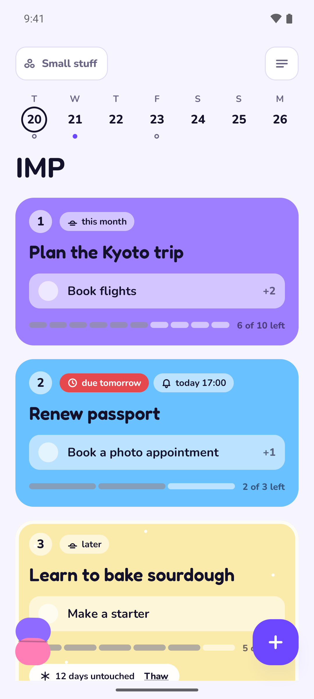
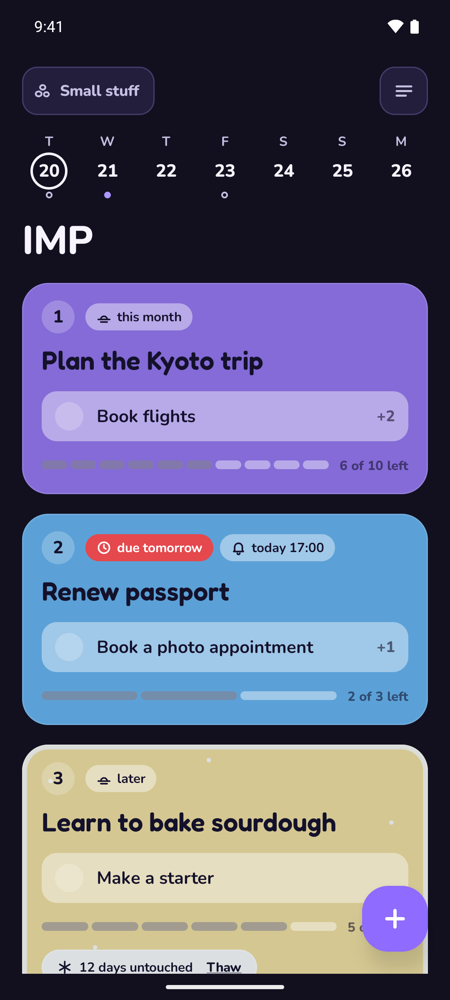
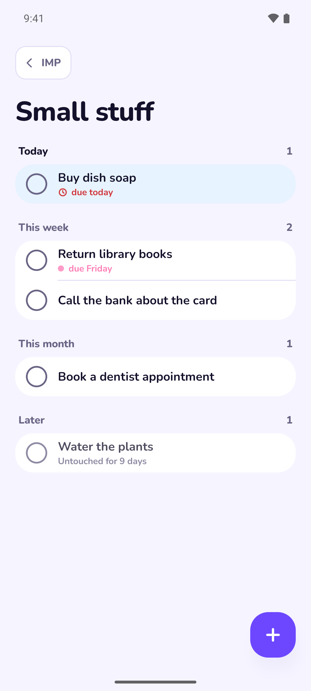
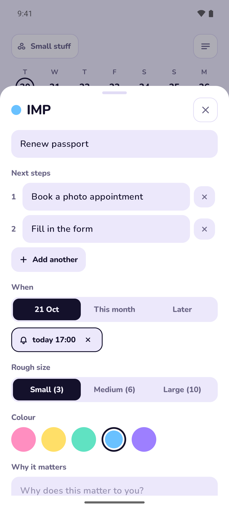
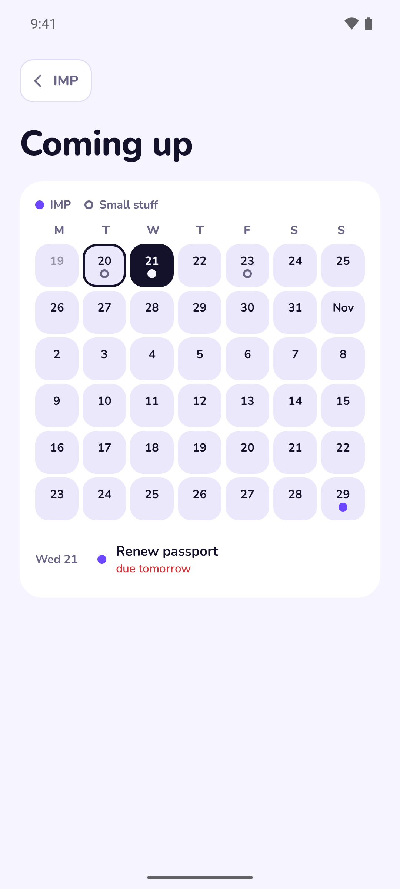
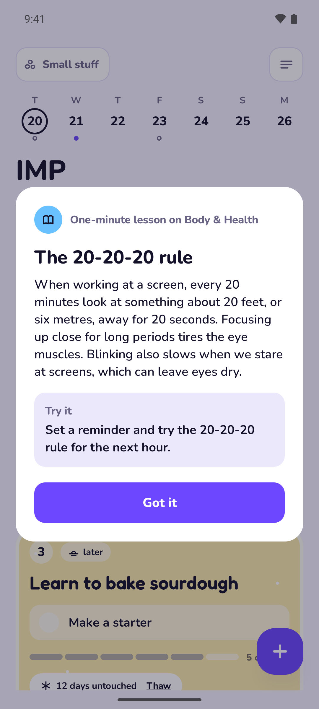

<div align="center">


# Accomplish

**A calm, offline to-do app that helps you get things done, big and small.**

[](https://github.com/viggnah/accomplish/releases/latest)
[](LICENSE)


<a href="https://github.com/viggnah/accomplish/releases/latest"></a>
<a href="https://apps.obtainium.imranr.dev/redirect?r=obtainium://add/https://github.com/viggnah/accomplish"></a>








</div>

## How it works

Accomplish keeps two kinds of task apart:

- **Big tasks**, called *IMP* by default: the important things you're working towards. Only these appear on Home, in a fixed number of spots (three by default).
- **Small tasks**, called *Small stuff* by default: everyday errands, one tap away and out of sight until you want them.

Both names are yours to change, along with *Waiting room* and *History*.

## Features

- **One next step at a time.** Each big task's card shows its next step. Tick it off and the following one appears, while a meter shows roughly how much is left.
- **Frost.** A big task you leave untouched slowly frosts over. One tap thaws it.
- **Deadlines or a rough when.** Give a task a date, or just "This month" or "Later". Anything due tomorrow or sooner turns red, and Coming up shows the next six weeks on a calendar.
- **Reminders that respect you.** Set your own reminders, with "In 1 hour" and "Tomorrow" snooze buttons. Optional nudges come two days and one day before a deadline, with quiet hours and a daily limit.
- **A Waiting room.** Big tasks that aren't on Home yet wait there until you place them. Tap an empty spot to add one straight to Home, and long-press a card to drag it to another spot.
- **Capsules.** Moving a big task forward sometimes earns a capsule, and finishing one always does. It might hold a note from your past self about why the task mattered, a side quest to do in real life (sometimes with someone you care about), or one of 250 one-minute lessons on cooking, music, history, science and more.
- **Undo** for anything that can't simply be put back, and a full history for every task.
- **Make it yours.** Choose the names, the number of spots, the timings, the notifications and the theme.
- **Light and dark**, in a soft pastel palette.

## Privacy

- **No internet permission.** The app can't send anything anywhere.
- No accounts, analytics, ads or tracking.
- Your tasks are a single readable JSON file in an `Accomplish` folder on your phone (or SD card, if you prefer), with daily backups next to it. Your settings are kept there too, so they come back after a reinstall.
- The app asks for "All files access" only so that folder can sit in your regular storage, where you can see it, copy it and back it up, and where it stays if the app is uninstalled.

## Install

Download the APK from [Releases](https://github.com/viggnah/accomplish/releases/latest) and open it, or add this repo to [Obtainium](https://github.com/ImranR98/Obtainium) to get updates automatically. Accomplish needs Android 11 or newer on a 64-bit ARM phone (arm64-v8a).

On first launch it asks for "All files access" and where to keep your data. Updates install over the top, and your data stays where it is.

To check that an APK is genuine, compare its signing certificate with this SHA-256 fingerprint, using [AppVerifier](https://github.com/soupslurpr/AppVerifier) or `apksigner verify --print-certs`:

```
D6:15:5C:52:08:41:D3:93:A5:D6:1D:E8:0E:86:A9:94:8B:F8:7B:4F:BC:7B:52:C8:9C:D6:AD:53:F1:FF:82:F5
```

## Build from source

You need JDK 17 or newer and the Android SDK. Point to the SDK with `sdk.dir` in `local.properties`, or set `ANDROID_HOME`.

```sh
./gradlew :app:testDebugUnitTest   # unit tests
./gradlew :app:assembleDebug       # app/build/outputs/apk/debug/app-debug.apk
./gradlew :app:assembleRelease     # app/build/outputs/apk/release/
```

A debug build installs alongside the release one, as "io.github.viggnah.accomplish.debug". To sign release builds, copy `keystore.properties.example` to `keystore.properties` and fill it in. Without it, the release APK is built unsigned.

### Install with adb

```sh
adb install -r app/build/outputs/apk/release/app-release.apk   # -r keeps your data
```

Over Wi-Fi (Android 11+): Developer options › Wireless debugging › Pair device with pairing code, then `adb pair <ip>:<pairing-port>` and `adb connect <ip>:<port>`. If adb finds the phone twice, pick one with `adb -s <serial>`.

## Project layout

| Path | What's there |
| --- | --- |
| `app/src/main/java/.../data` | Model, JSON format, settings, and folder storage with atomic writes and backups |
| `app/src/main/java/.../logic` | Pure rules (horizons, frost, spots, drain meter, reminders) and capsules |
| `app/src/main/java/.../notify` | Notifications, alarms and snooze |
| `app/src/main/java/.../ui` | Compose screens, sheets, theme and the undo toast |
| `app/src/main/assets/capsules.json` | 150 side quests and 250 one-minute lessons |
| `fastlane/metadata` | Store listing text, icon and screenshots |

The app uses only Kotlin, Jetpack Compose (foundation and UI, no Material) and AndroidX Activity, so the APK is about 2 MB.

## Contributing

Bug reports and ideas are welcome in [Issues](https://github.com/viggnah/accomplish/issues). Accomplish is a small personal project, so please open an issue to talk through anything big before sending a pull request. See [CONTRIBUTING.md](CONTRIBUTING.md).

## License

Accomplish is free software under the [GNU General Public License v3.0](LICENSE). It uses the Fredoka and Nunito fonts under the [SIL Open Font License 1.1](app/src/main/assets/licenses).
